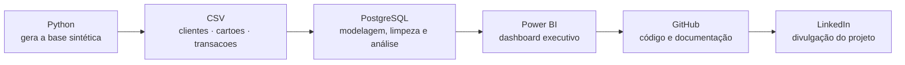
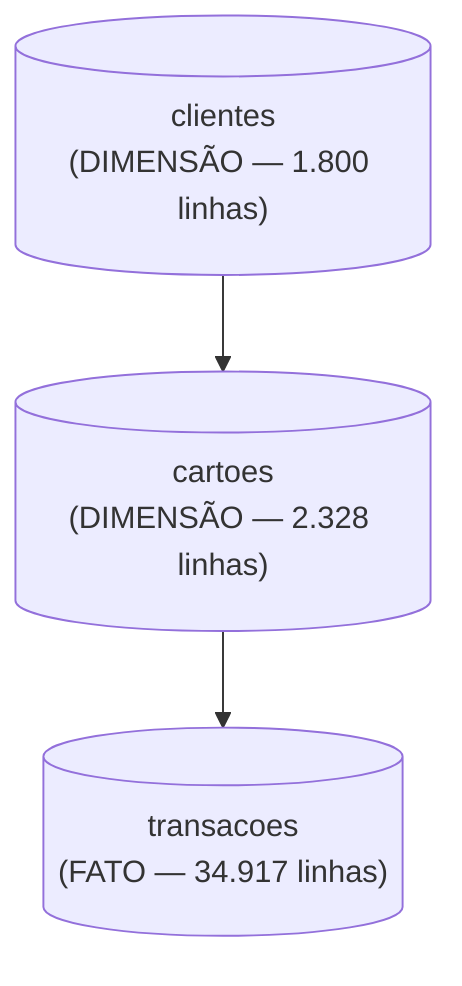

# Antifraude em Cartão de Crédito — Documentação do Projeto

Projeto de portfólio de Vitor França, engenheiro civil em transição para análise de dados.

Repositório: `projeto-fraudes-cartao` (GitHub) · Dashboard: Power BI

---

## Requisitos e Configurações do Projeto

### 1. Pré-requisitos de Software (Ambiente Local)

* PostgreSQL 14+ (instalação local, com `psql` e pgAdmin 4)
* Power BI Desktop
* Python 3.x, para gerar a base sintética
* Conta no GitHub
* Dataset: CSVs sintéticos gerados em Python (`clientes.csv`, `cartoes.csv`, `transacoes.csv`)

### 2. Fundamentos das Tecnologias

PostgreSQL – Conceitos Fundamentais (schema, DDL, constraints, window functions, CTE)
Power BI – Conceitos Fundamentais (modelo semântico, medidas DAX, colunas calculadas)
GitHub – Conceitos Fundamentais (repositório, README, commits)
Modelagem Relacional – Fundamentos (tabela dimensão x tabela fato)

### Dataset - Informações

Base sintética gerada em Python, calibrada com padrões públicos de fraude em cartão de crédito no Brasil — risco maior em compras online, em categorias de alto valor de revenda (eletrônicos, joalheria) e apostas online, risco maior em transações de madrugada e fora do estado de residência do cliente, e ticket bem mais alto na transação fraudulenta do que na legítima.

---

### 3. Principais Conceitos de Dados Utilizados

**Schema**
Namespace dentro do banco de dados que agrupa as tabelas do projeto (`antifraude`), separado do schema `public` padrão.
________________

**Taxa de fraude**
Percentual de transações marcadas como fraudulentas sobre o total de transações num recorte (categoria, canal, horário etc.) — o principal indicador de risco do projeto.
________________

**Window function `RANK`**
Função que atribui uma posição de ranking dentro de uma janela ordenada — usada aqui para ranquear categorias de estabelecimento e bandeiras de cartão pela taxa de fraude.
________________

**CTE (Common Table Expression)**
Tabela temporária criada dentro de uma query usando `WITH`, usada para calcular a taxa de fraude por grupo antes de aplicar `RANK` ou comparar com a janela inteira.
________________

**`PERCENTILE_CONT`**
Função estatística que calcula um percentil contínuo de uma distribuição — usada aqui para comparar a distribuição de valor (P25, mediana, P75) das transações fraudulentas contra as legítimas.
________________

**`FILTER (WHERE ...)`**
Cláusula que aplica uma condição dentro de uma função de agregação, sem precisar de subquery — usada em quase todo bloco de análise (ex: contar só as fraudes dentro de um `COUNT`).
________________

**`LAG`**
Função de janela que traz o valor de uma linha anterior dentro da mesma partição ordenada — usada aqui para medir a variação da taxa de fraude de um mês pro outro.
________________

**`BOOL_OR`**
Função de agregação que retorna verdadeiro se qualquer linha do grupo for verdadeira — usada aqui para marcar se um cliente já sofreu pelo menos uma fraude entre todas as suas transações.
________________

**Medida DAX**
No Power BI, cálculo definido em DAX que agrega dados sob demanda, como `Taxa de Fraude % = DIVIDE([Fraudes], [Total de Transações])`.
________________

**Modelo semântico**
Camada do Power BI onde ficam as tabelas, relacionamentos e medidas — a base sobre a qual os gráficos do dashboard são construídos.

---

## ◾ Fluxo das Ferramentas (Arquitetura do Projeto)



Papel de cada etapa no pipeline: Python entrega os dados brutos em CSV; PostgreSQL é onde o dado é modelado, limpo e analisado (é daqui que saem os números oficiais do projeto); Power BI transforma o resultado das análises num dashboard visual; GitHub documenta e publica o código e os resultados; LinkedIn divulga o projeto pronto.

---

## ◾ PostgreSQL - Conceitos

O PostgreSQL é o banco de dados relacional usado para modelar, limpar e analisar os dados do projeto.

Papel no pipeline: camada de modelagem e análise — é onde os CSVs viram tabelas estruturadas e onde saem todos os números usados no README e no dashboard.

Estrutura básica



Como foi usado no projeto: schema próprio (`antifraude`, não `public`), com chaves primárias, foreign keys e índices garantindo a integridade. Depois da carga, roda-se limpeza (checagem de duplicidade, órfãos e consistência entre `fraude` e `tipo_fraude`, colunas derivadas `faixa_horaria` e `fora_da_uf`) e os blocos de análise com CTE, `RANK`, `FILTER`, `PERCENTILE_CONT`, `LAG` e `BOOL_OR`.

Comandos principais

| Comando | O que faz |
|---|---|
| `psql -f 02_sql/01_criar_tabelas.sql` | Cria o schema, as tabelas, constraints e índices |
| `\copy tabela FROM 'arquivo.csv' WITH (FORMAT csv, HEADER true, DELIMITER ';')` | Carrega os dados do CSV na tabela |
| `SET search_path TO antifraude;` | Aponta a sessão pro schema do projeto |
| `psql -f 02_sql/04_analises.sql` | Roda os blocos de análise (categoria, canal, horário, UF, tipo de fraude) |

---

## ◾ Python - Conceitos

Usado só na etapa de geração da base sintética: cria os três CSVs (`clientes`, `cartoes`, `transacoes`) calibrados com padrões públicos de fraude em cartão de crédito, simulando a carteira de uma instituição fictícia sem usar dado real de nenhuma pessoa ou empresa.

---

## ◾ Power BI - Conceitos

O Power BI é a ferramenta de BI usada para montar o dashboard final do projeto.

Papel no pipeline: recebe o modelo direto dos CSVs de `03_dados/` e transforma os resultados das análises em visuais interativos.

Como foi usado no projeto: modelo semântico com relacionamentos `clientes → cartoes` e `cartoes → transacoes` (1 para muitos), colunas calculadas de faixa horária e transação fora da UF espelhando a limpeza feita em SQL, e medidas DAX — `Total de Transações`, `Fraudes`, `Taxa de Fraude %`, `Valor Total Transacionado`, `Valor Perdido em Fraude`, `% Valor Perdido`, `Ticket Médio Legítimo`, `Ticket Médio Fraude` entre outras.

Visuais usados, pelo nome exato no painel Visualizações do Power BI Desktop: **Cartão** (KPIs de topo), **Gráfico de Barras Agrupadas** (ranking de taxa de fraude por categoria), **Gráfico de Colunas Agrupadas** (taxa de fraude por canal e por faixa horária) e **Gráfico de Linhas** (evolução mensal da taxa de fraude).

---

## ◾ GitHub - Conceitos

Repositório público usado para publicar o código, os dados e a documentação do projeto.

Estrutura padrão de pastas

```
02_sql/
  01_criar_tabelas.sql       — DDL: schema, PKs, FKs, constraints, índices
  02_carregar_dados.sql      — \COPY dos CSV
  03_limpeza.sql             — checagens de qualidade, colunas derivadas
  04_analises.sql            — blocos de análise (categoria, canal, horário, UF, tipo de fraude)

03_dados/
  clientes.csv, cartoes.csv, transacoes.csv

04_prints/
  print_dashboard_final.png, print_sql_evolucao_mensal.png, print_sql_percentis_valor.png

documentos/
  DOCUMENTACAO_PROJETO.md

README.md
00_gerar_base.py
```

---

## 🎲 Dataset - Informações

### TABELA: clientes (dimensão)

Descrição: todo cliente titular de cartão na base, com dados cadastrais e score de crédito.

Colunas
* `cliente_id` — identificador único
* `nome_completo`, `idade`, `cidade`, `uf` — dados cadastrais
* `score_credito` — score de 300 a 950
* `data_cadastro` — data de entrada na base

### TABELA: cartoes (dimensão)

Descrição: cartões emitidos para os clientes — um cliente pode ter 1 ou 2 cartões.

Colunas
* `cartao_id` — identificador único
* `cliente_id` — referência ao titular
* `bandeira` — Visa, Mastercard, Elo ou American Express
* `tipo_cartao` — Crédito ou Múltiplo
* `limite_credito` — limite do cartão
* `data_emissao` — data de emissão

### TABELA: transacoes (fato)

Descrição: cada transação feita em 2025 nos cartões da base, com marcação de fraude.

Colunas
* `transacao_id` — identificador único
* `cartao_id` — referência ao cartão usado
* `data_hora` — data e hora da transação
* `valor` — valor da transação
* `categoria` — categoria do estabelecimento (10 categorias)
* `canal` — Presencial (maquininha), Online ou Aproximação (contactless)
* `uf_transacao` — UF onde a transação ocorreu
* `fraude` — se a transação foi identificada como fraudulenta
* `tipo_fraude` — Clonagem, Phishing, Cartão Perdido ou Roubado, ou Conta Invadida (preenchido só quando `fraude = true`)
* `faixa_horaria` — coluna derivada na limpeza (Madrugada, Manhã, Tarde ou Noite)
* `fora_da_uf` — coluna derivada na limpeza (transação fora da UF de residência do cliente)

### Relação entre as tabelas

`cliente_id` conecta `clientes` a `cartoes`. `cartao_id` conecta `cartoes` a `transacoes`. `transacoes` é a tabela fato usada para medir taxa de fraude, valor perdido e todos os cruzamentos de risco.

### Números confirmados

* Volume 2025: 1.800 clientes · 2.328 cartões · 34.917 transações
* Fraudes: 494 (1,41% das transações)
* Valor total transacionado: R$ 5.351.791,19 · Valor perdido em fraude: R$ 272.839,73 (5,10% do valor total)
* Ticket médio: legítimo R$ 147,55 · fraude R$ 552,31 (3,7x maior)
* Taxa de fraude por categoria, do maior pro menor: Apostas Online 4,96% · Joalheria 4,72% · Eletrônicos 4,23% · Passagens e Viagem 2,20% · Streaming e Assinaturas 1,41% · Vestuário 1,19% · Restaurantes 0,83% · Combustível 0,79% · Supermercado 0,74% · Farmácia 0,57%
* Taxa de fraude por canal: Online 2,78% · Aproximação (contactless) 0,74% · Presencial (maquininha) 0,71%
* Taxa de fraude por faixa horária: Madrugada 3,37% · Noite 1,42% · Manhã 1,35% · Tarde 1,24%
* Transação fora da UF do cliente: 2,50% de taxa de fraude contra 1,31% dentro da UF — 1,91x mais risco
* Distribuição de valor (P25/mediana/P75): legítima R$ 53,83 / R$ 98,39 / R$ 180,29 · fraude R$ 181,09 / R$ 328,90 / R$ 675,35
* Tipo de fraude mais comum: Phishing 33,81% · Clonagem 29,35% · Conta Invadida 19,64% · Cartão Perdido ou Roubado 17,21%
* Score de crédito médio: cliente que nunca sofreu fraude 644,0 · cliente que já sofreu fraude 648,4 — sem diferença relevante
* Taxa de fraude por bandeira: American Express 1,71% · Elo 1,67% · Visa 1,47% · Mastercard 1,23% — variação pequena, não é um fator de risco forte
* Evolução mensal: oscila entre 1,06% (setembro) e 1,69% (maio e outubro), sem tendência de alta ou queda ao longo do ano

Esses números vieram de execução real de SQL contra a base.

---

## Checklist de Execução

1. Definir o domínio do projeto (antifraude em cartão de crédito) e o escopo de dados
2. Gerar a base sintética em Python, calibrada com padrões reais de fraude
3. Escrever o DDL com schema próprio + constraints
4. Carregar e validar os dados (contagens batendo com o esperado)
5. Rodar limpeza e as análises reais em SQL — anotar os números exatos
6. Montar o dashboard em Power BI (extração via CSV, modelo, medidas, gráficos)
7. Criar o repositório no GitHub seguindo a estrutura de pastas padrão
8. Escrever o README seguindo o padrão de seções
9. Tirar os prints reais da execução (nunca fabricar print ou número)
10. Escrever o post do LinkedIn com os mesmos números do README
11. Revisar tudo contra a base real antes de publicar

---

## Armadilhas já mapeadas (para não repetir em projetos futuros)

* CSVs usam `;` como delimitador — sempre `DELIMITER ';'` no `\copy`.
* Tabelas ficam no schema `antifraude`, não em `public` — sempre `SET search_path` antes de qualquer query.
* Colunas nullable exportadas de pandas (`idade`, `score_credito`) precisam do tipo `Int64` (nullable) antes de virar CSV, senão viram `float` e quebram o `COPY` num campo inteiro.
* Coluna booleana (`fraude`) mapeada explicitamente para `t`/`f` antes de exportar, em vez de depender do `True`/`False` do pandas.
* `tipo_fraude` só pode vir preenchido quando `fraude = true` — checagem de consistência dedicada na limpeza, antes de qualquer análise.
* A coluna `fora_da_uf` depende de um `JOIN` entre `transacoes`, `cartoes` e `clientes` — calculada com `UPDATE ... FROM` na limpeza, não dá pra derivar só olhando a tabela `transacoes` sozinha.
* Servidor PostgreSQL rodando em ambiente sandbox/isolado morre entre execuções separadas de terminal — subir o servidor e rodar todos os scripts dentro da mesma sessão de comando.
* Conferir sempre se os números do texto batem com os números reais da execução antes de publicar.
